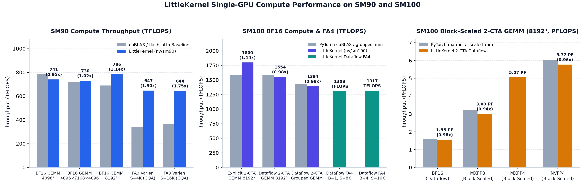
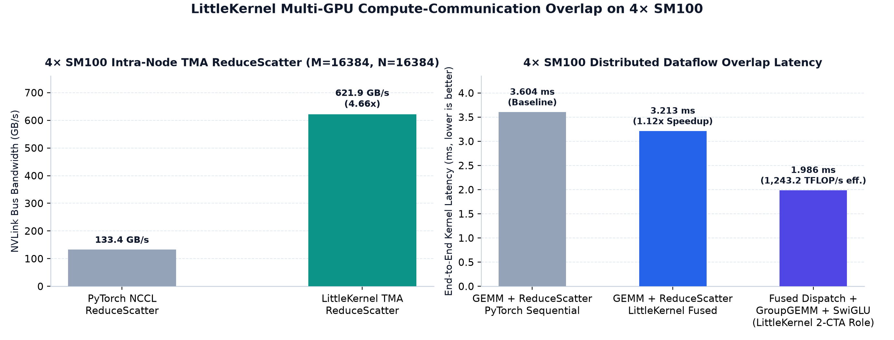
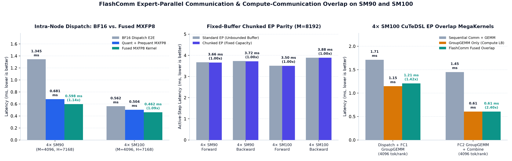
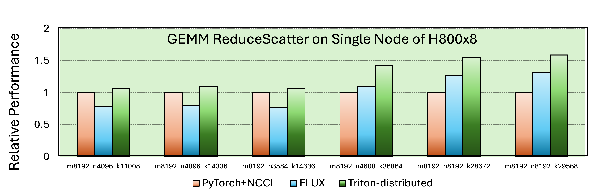
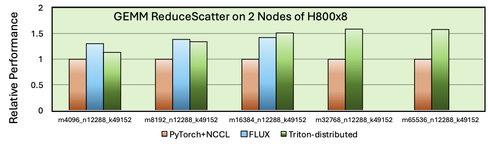

<div align="center">
 👋 大家好!
    <br>
    我们是 <b>ByteDance Seed team.</b>
</div>

<p align="center">
  欢迎通过以下方式以更好的了解我们👇
  <br>
  <a href="https://team.doubao.com/">
    </a>
  <a href="https://github.com/user-attachments/assets/93481cda-a7f3-47f3-b333-fe6b3da86b78">
    </a>
 <a href="https://www.xiaohongshu.com/user/profile/668e7e15000000000303157d?xsec_token=ABl2-aqekpytY6A8TuxjrwnZskU-6BsMRE_ufQQaSAvjc%3D&xsec_source=pc_search">
    </a>
  <a href="https://www.zhihu.com/org/dou-bao-da-mo-xing-tuan-dui/">
    </a>
</p>


# Triton-distributed

[原始Triton README](https://github.com/triton-lang/triton/blob/main/README.md) | [英文README](README.md) | [LittleKernel 文档](docs/little_kernel/index.rst) | [FlashComm 文档](docs/flashcomm/index.rst) | [编译指南](docs/build.md)

**Triton-distributed** 是面向现代多 GPU 集群**计算-通信重叠（Computation-Communication Overlapping）**构建的开源分布式 GPU 编译器与高性能算子栈。

目前仓库由三大核心模块协同组成：

- 🚀 **[LittleKernel](docs/little_kernel/index.rst)**（`python/little_kernel/`）：项目未来的主力下一代 Python GPU 算子编译器与 DSL，原生支持 **SM90**（`nv/sm90`）、**SM100**（`nv/sm100`）与 **GFX950**（`amd/cdna4`）。LittleKernel 在 Python 中直接暴露 warp-group `WGMMA`、1-CTA/2-CTA `tcgen05`（`UMMA`）、`TMEM`、`MFMA`、`TMA` 多播及 Global-to-LDS DMA 等底层硬件原语，并在 **SM100** 上提供自动化的 **Role & Dataflow** 多角色流水线编译器——单卡 `BF16` GEMM 最高达 **1,800 TFLOPS**（相对 cuBLAS **1.14x**），`NVFP4` GEMM 高达 **5.77 PFLOPS**。
- ⚡ **[FlashComm](docs/flashcomm/index.rst)**（`FlashComm/`）：面向 **SM90** 与 **SM100** 的高性能专家并行（EP）通信与通信计算融合库，涵盖节点内 NVLink 与跨节点多网卡 RDMA/GIN EP、**融合 `MXFP8` Dispatch**、**固定缓冲区分块 EP（Fixed-Buffer Chunked EP）**，以及基于 CuTeDSL 的 `Dispatch + GroupGEMM` 与 `GroupGEMM + Combine` 持久化融合 MegaKernel。
- 🧩 **[Triton-distributed 编译插件与原语](docs/primitives.md)**（`python/triton_dist/`）：基于 **Triton 3.7** 的 out-of-tree 分布式编译器插件，提供对称显存通信原语及开箱即用的 TP、MoE 与分布式 Flash-Decoding 重叠算子，性能媲美手写优化库（如 [Distributed-GEMM](https://github.com/NVIDIA/cutlass/tree/main/examples/65_distributed_gemm) 与 [FLUX](https://github.com/bytedance/flux/blob/main/README.md)）。

默认分支跟踪 **Triton 3.7**。此前的 Triton 3.4 线路保留在 [`triton-v3.4`](https://github.com/ByteDance-Seed/Triton-distributed/tree/triton-v3.4) 分支。Ascend 尚未接入 3.7 plugin 构建路径（`triton-ascend` 还没有 rebase 到 3.7）；可用的 Ascend 构建请使用 `triton-v3.4`。3.4 时期的 Ascend 源码停放在本分支的 [`ascend/`](ascend/README.md)，待基于 plugin 的移植就绪后再捞回。

## 最近更新
- 11/19/2026 🚀🚀🚀: 正式合入并发布主力下一代 Python GPU 编译器与 DSL **LittleKernel**（[PR #216](https://github.com/ByteDance-Seed/Triton-distributed/pull/216)），支持 **SM90**（`nv/sm90`）、**SM100**（`nv/sm100`）与 **GFX950**（`amd/cdna4`），内置 **SM100 Role & Dataflow** 自动流水线编译器，覆盖 `BF16` / `MXFP8` / `MXFP4` / `NVFP4` GEMM、Grouped GEMM、FlashAttention-3/4 与多卡计算-通信重叠算子。详见 [LittleKernel 文档](docs/little_kernel/index.rst) 与 [性能报告](docs/little_kernel/performance.rst)。
- 11/19/2026 ✨✨✨: 全新上线 **FlashComm** 文档并更新 **SM90** 与 **SM100** 实测性能，涵盖节点内 `BF16` Prefill/Decode EP、融合 `MXFP8` Dispatch、固定缓冲区分块 EP 以及 CuTeDSL `Dispatch + GroupGEMM` / `GroupGEMM + Combine` 融合 MegaKernel。详见 [FlashComm 文档](docs/flashcomm/index.rst)。
- 09/17/2026 ✨✨✨: FlashComm 融合 MXFP8 intra-node dispatch：expert-parallel 通信可以发送 packed FP8 而不是 BF16，并对 fused / prequantized 路径做 bitwise 对照。同时修复 MXFP8 launch template，支持调用者提供 EP 输出 buffer，并收紧 pinned-buffer 生命周期检查。
- 09/01/2026 ✨✨✨: FlashComm 固定缓冲区分块 EP：dispatch 与 combine 在固定大小的缓冲区上分块执行，EP 峰值显存不再随最坏情况的 token 数增长。EP overlap 缓冲区改为按需分配，EP kernel 覆盖的 hidden size 范围也进一步扩大。
- 08/17/2026 🚀🚀🚀: 升级到 Triton 3.7。Triton-distributed 现在作为 out-of-tree plugin 构建在上游 Triton 上。Triton 3.4 线路保留在 [`triton-v3.4`](https://github.com/ByteDance-Seed/Triton-distributed/tree/triton-v3.4)。
- 08/10/2026 ✨✨✨: 更新 AMD MORI 后端，恢复 fused-MoE 所需的 cooperative SHMEM API。
- 08/07/2026 ✨✨✨: SM90 / SM100 GPU 上融合 inter-node CuTeDSL dispatch/combine。
- 08/06/2026 ✨✨✨: 支持 Ascend RDMA（[PR #179](https://github.com/ByteDance-Seed/Triton-distributed/pull/179)）。
- 07/21/2026 ✨✨✨: FlashComm 支持跨节点与多 NIC EP。
- 07/12/2026 ✨✨✨: FlashComm CUDA 通信库（含 EP overlap）、TMA、`TRITON_DIST_CGA_CLUSTER_SIZE`、Triton host-overhead 优化，以及 AMD mori-shmem EP intra-node / 低延迟 kernel。
- 06/30/2026 ✨✨✨: SM90 GPU 上融合 intra-node CuTeDSL dispatch/combine（dispatch+FC1 与 FC2+combine）。
- 08/24/2025 ⚡⚡⚡：支持 [ByteDance-Seed/Seed-OSS-36B-Instruct](https://huggingface.co/ByteDance-Seed/Seed-OSS-36B-Instruct) 的推理加速，实现 1.33 倍加速。
- 08/13/2025 ✨✨✨: MegaTritonKernel 实现以及 Qwen3 TP demo，详情参见 [MegaKernel Doc](https://github.com/ByteDance-Seed/Triton-distributed/blob/main/docs/getting-started/megakernel/megakernel.md)。
- 08/06/2025 ✨✨✨: 支持 GEMM+AllReduce 算子以及 MoE TP 算子，详情参见 [GEMM+AR Test](https://github.com/ByteDance-Seed/Triton-distributed/blob/main/python/triton_dist/test/nvidia/test_gemm_ar.py) 和 [MOE Test](https://github.com/ByteDance-Seed/Triton-distributed/blob/main/python/triton_dist/test/nvidia/test_moe_reduce_rs.py)。
- 07/24/2025 🤖🤖🤖：引入端到端推理加速 demo，统一支持 NVIDIA 和 AMD GPU。详情请参阅[文档](https://github.com/ByteDance-Seed/Triton-distributed/blob/main/docs/getting-started/e2e/e2e_dense.md)。
- 07/11/2025 ✨✨✨: 高性能AllReduce kernel实现。请见[AllReduce Test](https://github.com/ByteDance-Seed/Triton-distributed/blob/main/python/triton_dist/test/nvidia/test_allreduce.py)。
- 07/11/2025 ✨✨✨: 性能更优的TP MoE kernel。 请见 [AG+MoE Test](https://github.com/ByteDance-Seed/Triton-distributed/blob/main/python/triton_dist/test/nvidia/test_ag_moe.py) 和 [MoE+RS Test](https://github.com/ByteDance-Seed/Triton-distributed/blob/main/python/triton_dist/test/nvidia/test_moe_reduce_rs.py)。
- 07/11/2025 ✨✨✨: Triton 3.4 和 NVSHMEM4py 支持，请见 ([MR](https://github.com/ByteDance-Seed/Triton-distributed/pull/54)). 可以无需修改代码直接`pip install`。
- 05/12/2025 🚀🚀🚀: 我们的论文 `TileLink: Generating Efficient Compute-Communication Overlapping Kernels using Tile-Centric Primitives` 被 MLSys 2025接收！

## 快速入门

### 1. LittleKernel 快速上手（`SM90`、`SM100`、`GFX950`）

LittleKernel 的 CPU 代码生成仅依赖 **Python 3.11+** 与 **NumPy**；在配备 NVIDIA（`nvcc`）或 AMD（`hipcc`）工具链的目标 GPU 环境中即可直接 JIT 编译并运行算子：

```bash
export PYTHONPATH="python:."
# 运行仓库与后端隔离契约测试
pytest -q tests/repository

# 在目标硬件上运行 SM90 / SM100 / GFX950 基准测试
python3 benchmarks/nv/sm90/gemm/sm90_deepgemm_full_optimizations.py
python3 benchmarks/nv/sm100/gemm/sm100_deepgemm_matching_architecture.py
python3 benchmarks/nv/sm100/dataflow/bench_nvfp4_gemm.py
```

完整教程与参考手册请参阅 [LittleKernel 文档](docs/little_kernel/index.rst)（含 [快速开始](docs/little_kernel/getting-started.rst)、[编译器架构](docs/little_kernel/architecture.rst)、[DSL 语法参考](docs/little_kernel/dsl-reference.rst)、[SM100 Role & Dataflow 编译器](docs/little_kernel/dataflow.rst) 与 [硬件内联原语](docs/little_kernel/intrinsics.rst)）。

### 2. FlashComm 快速上手（`SM90`、`SM100`）

```bash
cd FlashComm
CUSTOM_CUDA_ARCH="10.0a;9.0" pip install -e . --no-build-isolation
```

`EPKernels`、融合 `MXFP8` Dispatch、`EPChunkPlanner` 固定缓冲区分块 EP 与 `EPOverlapKernels` CuTeDSL 重叠算子说明请见 [FlashComm 文档](docs/flashcomm/index.rst)。

### 3. Triton-distributed 源码编译安装

[安装指导](docs/build.md)

### 如何使用 Triton-distributed 原语
Triton-distributed 提供了一套易于使用的原语，用于支持开发计算-通信融合的分布式kernel。

[Triton-distributed 原语](docs/primitives.md)

使用这些原语，用户可以轻松编写通信kernel。例如，以下展示了一个低延迟的AllToAll通信操作（在推理场景下，其延迟表现优于[DeepEP](https://github.com/deepseek-ai/DeepEP)）。这个例子在 32 卡 **SM90** 集群中性能是 `137` 微秒（每卡 `128` token，`topk=8`，`hidden_size=7168`，数据类型 `fp8`），DeepEP 是 `182` 微秒（DeepEP 推理不使用 NVLink）。
```py
@triton_dist.jit
def all_to_all_kernel(
    data_src,
    data_dst,
    splits_src,
    splits_dst,
    signal,
    splits_cumsum,
    scale_src,
    scale_dst,
    rank: int,
    call_count: int,
    WITH_SCALE: tl.constexpr,
    WORLD_SIZE: tl.constexpr,
    HIDDEN: tl.constexpr,
    MAX_M: tl.constexpr,
    EXPERTS_PER_RANK: tl.constexpr,
    NUM_TOT_EXPERTS: tl.constexpr,
    ELEMENT_SIZE: tl.constexpr = 2,
    SCALE_ELEMENT_SIZE: tl.constexpr = 4,
):
    pid = tl.program_id(0)
    threadidx = tid(axis=0)

    exp_st = pid * EXPERTS_PER_RANK
    exp_ed = exp_st + EXPERTS_PER_RANK

    m_st = tl.load(splits_cumsum + exp_st)
    m_ed = tl.load(splits_cumsum + exp_ed)
    num_rows_cur_block = m_ed - m_st

    src_off = m_st
    dst_off = rank * MAX_M

    split_src_ptr = splits_src + exp_st
    off0 = exp_st + tl.arange(0, EXPERTS_PER_RANK)
    off1 = exp_st + tl.arange(0, EXPERTS_PER_RANK) + 1
    cumsum_sts = tl.load(splits_cumsum + off0)
    cumsum_eds = tl.load(splits_cumsum + off1)
    tl.store(split_src_ptr + tl.arange(0, EXPERTS_PER_RANK), cumsum_eds - cumsum_sts)

    act_pos = call_count % 2
    data_dst_ptr = data_dst + act_pos * WORLD_SIZE * MAX_M * HIDDEN + dst_off * HIDDEN
    split_dst_ptr = splits_dst + act_pos * NUM_TOT_EXPERTS + rank * EXPERTS_PER_RANK
    signal_ptr = signal + act_pos * WORLD_SIZE + rank

    libshmem_device.putmem_nbi_block(
        data_dst_ptr,
        data_src + src_off * HIDDEN,
        num_rows_cur_block * HIDDEN * ELEMENT_SIZE,
        pid,
    )
    libshmem_device.putmem_nbi_block(
        split_dst_ptr,
        split_src_ptr,
        EXPERTS_PER_RANK * 4,  # now we use `int32` for splits
        pid,
    )
    if WITH_SCALE:
        scale_dst_ptr = scale_dst + act_pos * WORLD_SIZE * MAX_M + dst_off
        libshmem_device.putmem_signal_nbi_block(
            scale_dst_ptr,
            scale_src + src_off,
            num_rows_cur_block * SCALE_ELEMENT_SIZE,
            signal_ptr,
            call_count,
            libshmem_device.NVSHMEM_SIGNAL_SET,
            pid,
        )

    libshmem_device.fence()
    if threadidx == 0:
        if not WITH_SCALE:
            libshmem_device.signal_op(
                signal_ptr,
                call_count,
                libshmem_device.NVSHMEM_SIGNAL_SET,
                pid,
            )
        libshmem_device.signal_wait_until(
            signal + act_pos * WORLD_SIZE + pid,
            libshmem_device.NVSHMEM_CMP_EQ,
            call_count,
        )
```

此外，用户可以将通信部分与计算部分结合，设计计算-通信融合的kernel。我们在`python/triton_dist/kernels`目录下提供了示例实现。

## Performance

### LittleKernel 在 SM90 与 SM100 上的性能

LittleKernel 在保持 Python 可读性的同时，在 **SM90**（`nv/sm90`）与 **SM100**（`nv/sm100`）上实现了媲美乃至超越底层厂商算子库的吞吐表现：





| 架构 | 算子与规模 | LittleKernel 实测 | 基线（`cuBLAS` / `PyTorch` / `flash_attn`） | 相对表现 |
| :--- | :--- | :--- | :--- | :--- |
| **SM90** (`nv/sm90`) | `BF16` GEMM (`4096 × 7168 × 4096`) | **730.0 TFLOPS** (`0.329 ms`) | 718.2 TFLOPS (`0.335 ms`, cuBLAS) | **1.02x** |
| **SM90** (`nv/sm90`) | `BF16` GEMM (`8192 × 8192 × 8192`) | **785.5 TFLOPS** (`1.400 ms`) | 690.4 TFLOPS (`1.593 ms`, cuBLAS) | **1.14x** |
| **SM90** (`nv/sm90`) | FlashAttention-3 Varlen (`B=8, S=4096, GQA 32/8`) | **646.9 TFLOPS** (`1.700 ms`) | 340.0 TFLOPS (`3.235 ms`, `flash_attn`) | **1.90x** |
| **SM100** (`nv/sm100`) | 显式 2-CTA `BF16` GEMM (`8192³`) | **1,800.3 TFLOPS** (`0.611 ms`) | 1,581.2 TFLOPS (`0.695 ms`, cuBLAS) | **1.14x** |
| **SM100** (`nv/sm100`) | Dataflow 2-CTA `MXFP8` / `MXFP4` / `NVFP4` GEMM (`8192³`) | **3.00 / 5.07 / 5.77 PFLOPS** | 3.20 / — / 6.03 PFLOPS (`_scaled_mm`) | **0.94x–0.96x** |
| **SM100** (`nv/sm100`) | Dataflow 2-CTA `BF16` Grouped GEMM (`E=40, M=29440`) | **1,393.6 TFLOPS** (`1.772 ms`) | 1,428.3 TFLOPS (`1.729 ms`, `grouped_mm`) | **0.98x** |
| **SM100** (`nv/sm100`) | Dataflow FlashAttention-4 Fwd (`B=4, S=16384, GQA 32/8`) | **1,316.9 TFLOPS** (`26.72 ms`) | 与 PyTorch SDPA 精度验证通过 | PASS |
| 4× **SM100** | 节点内 `TMA` ReduceScatter 与融合 `GEMM + RS` | **621.9 GB/s** busbw / **3.213 ms** | 133.4 GB/s / 3.604 ms (`PyTorch` NCCL) | **4.66x** 带宽 / **1.12x** 端到端 |
| 4× **SM100** | 融合 `Dispatch + GroupGEMM + SwiGLU` (`4096 tok/rank`) | **1.986 ms**（等效 **1,243.2 TFLOP/s**） | 与 PyTorch 参考实现精度验证通过 | 单一持久化 2×2 Cluster 算子 |

完整数据与复现命令（含 **GFX950** `amd/cdna4` `MXFP8` `MFMA` GEMM 基准脚本说明）请参见 [docs/little_kernel/performance.rst](docs/little_kernel/performance.rst)。

### FlashComm 在 SM90 与 SM100 上的性能



| 架构 | FlashComm 测试负载（`H=7168, E=256, topk=8`） | 实测延迟与带宽 | 核心加速比与特性 |
| :--- | :--- | :--- | :--- |
| 4× **SM90** | 节点内 `BF16` EP（`M=4096` Prefill / `M=128` Decode） | `1.345 ms` disp, `1.570 ms` comb / `0.298 ms` disp, **`0.080 ms`** comb | `149–152 GB/s` 远端 NVLink 有效载荷；`3,004 GB/s` HBM |
| 4× **SM100** | 节点内 `BF16` EP（`M=4096` Prefill / `M=128` Decode） | **`0.562 ms`** disp, **`0.690 ms`** comb / `0.623 ms` disp, **`0.119 ms`** comb | 相比 4× SM90 Dispatch 快 **2.39x**、Combine 快 **2.28x** |
| 4× **SM90** | 融合 `MXFP8` 节点内 Dispatch（`M=4096`） | **`0.598 ms`**（`137.8 GB/s` 远端有效载荷） | 相比独立量化+通信快 **1.14x**（相比 BF16 算子快 **2.25x**） |
| 4× **SM100** | 融合 `MXFP8` 节点内 Dispatch（`M=4096`） | **`0.462 ms`**（`178.2 GB/s` 远端有效载荷） | 相比独立量化+通信快 **1.09x**（独立量化达 `1,010.5 GB/s`） |
| 4× **SM90** / **SM100** | 固定缓冲区分块 EP（`M=8192, chunk=1024`） | `3.66 ms` / `3.50 ms` fwd；空步仅 `12.7 µs` / `18.1 µs` | 活跃分块零额外开销（**1.00x**），显存峰值严格受控 |
| 4× **SM100** | CuTeDSL 融合 `Dispatch + FC1 GroupGEMM`（`4096 tok/rank`） | **`1.208 ms`**（`1,428.7 TFLOPS` + `348.8 GB/s` disp.） | 相比串行快 **1.42x**（隐藏 `89%` Dispatch 通信耗时） |
| 4× **SM100** | CuTeDSL 融合 `FC2 GroupGEMM + Combine`（`4096 tok/rank`） | **`0.605 ms`**（`1,425.7 TFLOPS` + `696.2 GB/s` comb.） | Kernel 级加速 **2.40x**（端到端均值加速 `1.17x`） |

完整 API 说明与复现命令请参见 [docs/flashcomm/index.rst](docs/flashcomm/index.rst)。

### Triton-distributed 插件 TP 与 Flash-Decode 性能

#### AllGather GEMM 单机 8× SM90


#### GEMM ReduceScatter 单机 8× SM90


#### AllGather GEMM 双机 8× SM90


#### GEMM ReduceScatter 双机 8× SM90


#### 分布式 Flash-Decode 从单机到四机扩展情况


#### 其他平台性能
[AMD GPUs](docs/amd-perf.md)

## Roadmaps
### 功能
- [x] Release low-level primitives
- [x] Release LittleKernel Python GPU compiler & SM100 Role/Dataflow frontend
- [ ] Release high-level Triton-distributed primitives
- [x] Tutorials
- [x] Pre-built binary
### Kernels
- [x] Release single-node GEMM TP overlapping kernels
- [x] Release single-node MoE TP overlapping kernels
- [x] Release single-node distributed Flash-Decoding kernels
- [x] Release single-node MoE EP overlapping kernels (`FlashComm` & `LittleKernel`)
- [x] Release cross-node GEMM TP overlapping kernels
- [x] Release cross-node MoE TP overlapping kernels
- [x] Release cross-node distributed Flash-Decoding kernels
- [x] Release cross-node EP all-to-all kernels (similar to [DeepEP](https://github.com/deepseek-ai/DeepEP))
- [x] Provide tutorials for kernel implementation
### 后端
计算能力
- [x] Nvidia SM100 support
- [x] Nvidia SM90a support
- [x] Nvidia SM80 support
- [x] Nvidia SM89 support
- [x] AMD CDNA4 (GFX950) support
- [x] AMD CDNA3 support

通信能力
- [x] NVLink
- [x] IB / RoCE (NCCL GIN & NVSHMEM)
- [x] PCIe

### 性能
- [x] Performance report

## 许可协议
Triton-distributed 主体采用 [MIT License](LICENSE)（`Copyright (c) 2025-2026 ByteDance Ltd. and/or its affiliates`）。
我们的代码中有一些是 Apache-2.0 License 的:
- `python/triton_dist/kernels/nvidia/flash_decode.py`

Triton 原本有些代码也是 Apache-2.0 License 的:
- `include/triton/Dialect/TritonGPU/Transforms/PipelineExpander.h`

## 引用
如在学术研究中使用 Triton-distributed、LittleKernel 或 FlashComm，欢迎引用以下相关论文：

- **UniEP (HPDC '26)**：[UniEP: Unified Expert-Parallel MegaKernel MoE for LLM Training](https://dl.acm.org/doi/10.1145/3806645.3807818)
- **DITRON (ICML 2026)**：[DITRON: Distributed Multi-level Tiling Compiler for Parallel Tensor Programs](https://icml.cc/virtual/2026/poster/63503)
- **Triton-distributed (arXiv 2025)**：[Triton-distributed: Programming Overlapping Kernels on Distributed AI Systems with the Triton Compiler](https://arxiv.org/abs/2504.19442)
- **TileLink (MLSys 2025)**：[TileLink: Generating Efficient Compute-Communication Overlapping Kernels using Tile-Centric Primitives](https://arxiv.org/abs/2503.20313)

```bibtex
@inproceedings{zheng2026uniep,
  title={UniEP: Unified Expert-Parallel MegaKernel MoE for LLM Training},
  author={Zheng, Size and Zheng, Xuegui and Chang, Li-Wen and Zhai, Jidong},
  booktitle={Proceedings of the 35th International Symposium on High-Performance Parallel and Distributed Computing},
  series={HPDC '26},
  pages={387--401},
  year={2026},
  publisher={ACM},
  doi={10.1145/3806645.3807818},
  url={https://dl.acm.org/doi/10.1145/3806645.3807818}
}

@inproceedings{zheng2026ditron,
  title={DITRON: Distributed Multi-level Tiling Compiler for Parallel Tensor Programs},
  author={Zheng, Size and Zheng, Xuegui and Sun, Hanshi and Hou, Qi and Bao, Wenlei and Li, Shiyu and Duanmu, Haojie and Fang, Jin and Xue, Chenli and Huang, Chenhui and Liu, Yuanqiang and Chen, Renze and Zheng, Ningxin and Wang, Dongyang and Chang, Li-Wen and Lu, Liqiang and Liang, Yun and Zhai, Jidong and Liu, Xin},
  booktitle={Forty-third International Conference on Machine Learning (ICML)},
  year={2026},
  url={https://icml.cc/virtual/2026/poster/63503}
}

@misc{zheng2025tritondistributed,
      title={Triton-distributed: Programming Overlapping Kernels on Distributed AI Systems with the Triton Compiler},
      author={Size Zheng and Wenlei Bao and Qi Hou and Xuegui Zheng and Jin Fang and Chenhui Huang and Tianqi Li and Haojie Duanmu and Renze Chen and Ruifan Xu and Yifan Guo and Ningxin Zheng and Ziheng Jiang and Xinyi Di and Dongyang Wang and Jianxi Ye and Haibin Lin and Li-Wen Chang and Liqiang Lu and Yun Liang and Jidong Zhai and Xin Liu},
      year={2025},
      eprint={2504.19442},
      archivePrefix={arXiv},
      primaryClass={cs.DC},
      url={https://arxiv.org/abs/2504.19442},
}
@article{zheng2025tilelink,
  title={Tilelink: Generating efficient compute-communication overlapping kernels using tile-centric primitives},
  author={Zheng, Size and Fang, Jin and Zheng, Xuegui and Hou, Qi and Bao, Wenlei and Zheng, Ningxin and Jiang, Ziheng and Wang, Dongyang and Ye, Jianxi and Lin, Haibin and others},
  journal={arXiv preprint arXiv:2503.20313},
  year={2025}
}
```

# 关于 [ByteDance Seed Team](https://team.doubao.com/)

字节跳动Seed团队成立于 2023 年，致力于打造行业内最先进的人工智能基础模型。该团队立志成为世界一流的研究团队，并为科学进步和社会发展做出重大贡献。
