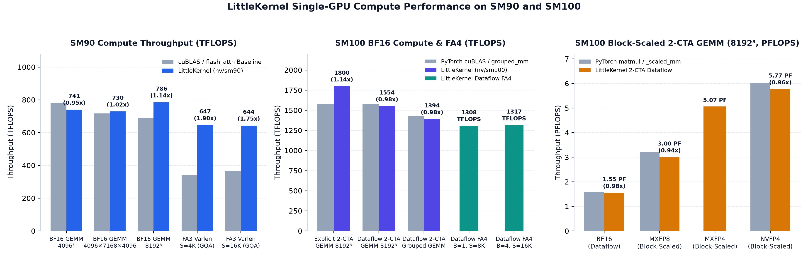
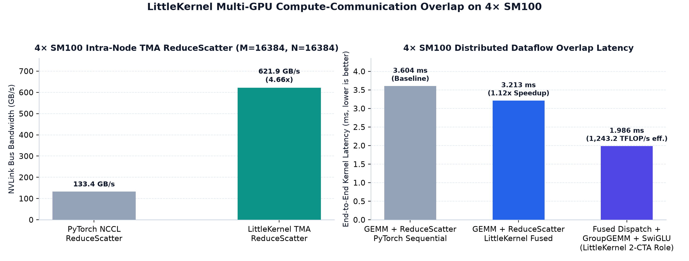
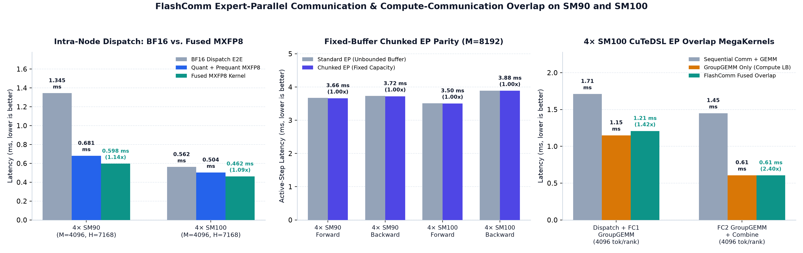
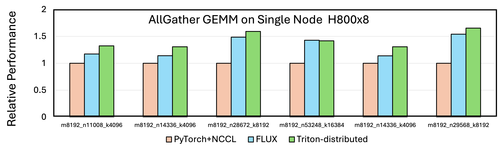
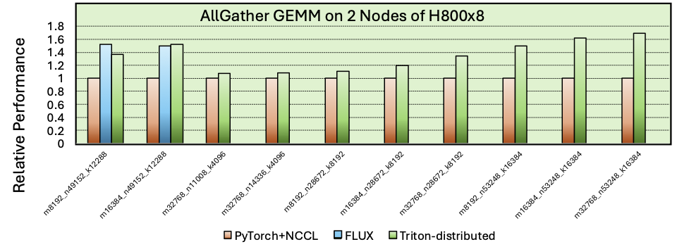
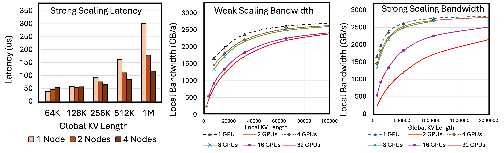

<div align="center">
 👋 Hi, everyone!
    <br>
    We are <b>ByteDance Seed team.</b>
</div>

<p align="center">
  You can get to know us better through the following channels👇
  <br>
  <a href="https://team.doubao.com/">
    </a>
  <a href="https://github.com/user-attachments/assets/93481cda-a7f3-47f3-b333-fe6b3da86b78">
    </a>
 <a href="https://www.xiaohongshu.com/user/profile/668e7e15000000000303157d?xsec_token=ABl2-aqekpytY6A8TuxjrwnZskU-6BsMRE_ufQQaSAvjc%3D&xsec_source=pc_search">
    </a>
  <a href="https://www.zhihu.com/org/dou-bao-da-mo-xing-tuan-dui/">
    </a>
</p>


# Triton-distributed

[Original Triton README](https://github.com/triton-lang/triton/blob/main/README.md) | [README in Chinese](README-cn.md) | [LittleKernel Docs](docs/little_kernel/index.rst) | [FlashComm Docs](docs/flashcomm/index.rst) | [Build Guide](docs/build.md)

**Triton-distributed** is an open-source distributed GPU compiler and kernel stack engineered for high-efficiency **computation-communication overlapping** across modern multi-GPU clusters.

Today, the repository brings together three tightly integrated pillars:

- 🚀 **[LittleKernel](docs/little_kernel/index.rst)** (`python/little_kernel/`): Our flagship next-generation Python GPU kernel DSL and compiler targeting **SM90** (`nv/sm90`), **SM100** (`nv/sm100`), and **GFX950** (`amd/cdna4`). LittleKernel gives developers zero-ceiling access to warp-group `WGMMA`, 1-CTA/2-CTA `tcgen05` (`UMMA`), `TMEM`, `MFMA`, `TMA` multicast, and global-to-LDS DMA—together with an automatic **SM100 Role & Dataflow** pipeline compiler that reaches up to **1,800 TFLOPS** (`1.14x` vs. cuBLAS) in `BF16` GEMM and **5.77 PFLOPS** in `NVFP4` GEMM.
- ⚡ **[FlashComm](docs/flashcomm/index.rst)** (`FlashComm/`): A production-grade Expert-Parallel (EP) communication and compute-communication overlap library for **SM90** and **SM100**, featuring intra-node NVLink and cross-node multi-NIC RDMA/GIN EP, **fused `MXFP8` dispatch**, **fixed-buffer chunked EP**, and CuTeDSL persistent MegaKernels fusing `Dispatch + GroupGEMM` and `GroupGEMM + Combine`.
- 🧩 **[Triton-distributed Plugin & Primitives](docs/primitives.md)** (`python/triton_dist/`): An out-of-tree distributed compiler plugin built on **Triton 3.7**, exposing tile-centric symmetric-memory communication primitives alongside ready-to-use TP, MoE, and distributed Flash-Decoding kernels comparable to hand-tuned libraries ([Distributed-GEMM](https://github.com/NVIDIA/cutlass/tree/main/examples/65_distributed_gemm) and [FLUX](https://github.com/bytedance/flux/blob/main/README.md)).

The default branch tracks **Triton 3.7**. The previous Triton 3.4 line is kept on the [`triton-v3.4`](https://github.com/ByteDance-Seed/Triton-distributed/tree/triton-v3.4) branch. Ascend is not on the 3.7 plugin build path yet (`triton-ascend` has not rebased onto 3.7); use `triton-v3.4` for a working Ascend build. The 3.4-era Ascend sources are parked under [`ascend/`](ascend/README.md) on this branch until a plugin-based port exists.

## News
- 11/19/2026 🚀🚀🚀: Released **LittleKernel** ([PR #216](https://github.com/ByteDance-Seed/Triton-distributed/pull/216)), our flagship Python GPU compiler and DSL targeting **SM90** (`nv/sm90`), **SM100** (`nv/sm100`), and **GFX950** (`amd/cdna4`), complete with an automatic **SM100 Role & Dataflow** pipeline compiler, block-scaled `MXFP8` / `MXFP4` / `NVFP4` GEMM, Grouped GEMM, FlashAttention-3/4, and multi-GPU overlap kernels. See the [LittleKernel Docs](docs/little_kernel/index.rst) and [Performance Benchmarks](docs/little_kernel/performance.rst).
- 11/19/2026 ✨✨✨: Published comprehensive **FlashComm** documentation and refreshed **SM90** & **SM100** benchmarks covering intra-node `BF16` prefill/decode EP, fused `MXFP8` dispatch, fixed-buffer chunked EP, and CuTeDSL fused `Dispatch + GroupGEMM` / `GroupGEMM + Combine` MegaKernels. See the [FlashComm Docs](docs/flashcomm/index.rst).
- 09/17/2026 ✨✨✨: FlashComm fused MXFP8 intra-node dispatch: expert-parallel traffic can send packed FP8 instead of BF16, with bitwise checks against fused and prequantized paths. MXFP8 launch templates, caller-owned EP output buffers, and pinned-buffer lifetime checks are also tightened.
- 09/01/2026 ✨✨✨: FlashComm fixed-buffer chunked EP: dispatch and combine run in chunks over a fixed-size buffer, so peak EP memory no longer scales with the worst-case token count. EP overlap buffers are also sized on demand, and the EP kernels cover a wider range of hidden sizes.
- 08/17/2026 🚀🚀🚀: Upgraded to Triton 3.7. Triton-distributed now builds as an out-of-tree plugin against stock upstream Triton. The Triton 3.4 line is kept on [`triton-v3.4`](https://github.com/ByteDance-Seed/Triton-distributed/tree/triton-v3.4).
- 08/10/2026 ✨✨✨: AMD MORI backend update restoring fused-MoE cooperative SHMEM APIs.
- 08/07/2026 ✨✨✨: Fused inter-node CuTeDSL dispatch/combine on SM90 and SM100 GPUs.
- 08/06/2026 ✨✨✨: Ascend RDMA support ([PR #179](https://github.com/ByteDance-Seed/Triton-distributed/pull/179)).
- 07/21/2026 ✨✨✨: FlashComm cross-node and multi-NIC EP.
- 07/12/2026 ✨✨✨: FlashComm CUDA communication library with EP overlap, TMA support, `TRITON_DIST_CGA_CLUSTER_SIZE`, Triton host-overhead optimization, and AMD mori-shmem EP intra-node / low-latency kernels.
- 06/30/2026 ✨✨✨: Fused intra-node CuTeDSL dispatch/combine on SM90 GPUs (dispatch+FC1 and FC2+combine).
- 12/22/2025 ✨✨✨: Updated EP functions, support low-latency mode, token saving, and Mega-EP.
- 21/10/2025 🔥🔥🔥: Triton-distributed is presented at [Triton Conference 2025](https://tritonconference.eventbuilder.com/TritonDeveloperConference?ref=TritonDeveloperConference), see the [talk](https://www.youtube.com/playlist?list=PLc_vA1r0qoiQqCdWFDUDqI90oY5EjfGuO) for details.
- 09/03/2025 ✨✨✨: Introduced Intra-Kernel Profiler, See the [doc](https://github.com/ByteDance-Seed/Triton-distributed/blob/main/docs/getting-started/profiler/intra_kernel_profiler.md) for details.
- 08/24/2025 ⚡⚡⚡: Support inference acceleration for [ByteDance-Seed/Seed-OSS-36B-Instruct](https://huggingface.co/ByteDance-Seed/Seed-OSS-36B-Instruct), achieving a 1.33x speedup.
- 08/13/2025 ✨✨✨: Introduced the MegaTritonKernel and provided a Qwen3 TP demo, See the [doc](https://github.com/ByteDance-Seed/Triton-distributed/blob/main/docs/getting-started/megakernel/megakernel.md) for details.
- 08/06/2025 ✨✨✨: Support GEMM+AllReduce and MoE TP operators, see [GEMM+AR Test](https://github.com/ByteDance-Seed/Triton-distributed/blob/main/python/triton_dist/test/nvidia/test_gemm_ar.py) and [MOE Test](https://github.com/ByteDance-Seed/Triton-distributed/blob/main/python/triton_dist/test/nvidia/test_moe_reduce_rs.py) for detail.
- 07/24/2025 🤖🤖🤖: Introduced end-to-end inference acceleration demo with unified support for both NVIDIA and AMD GPUs. See the [doc](https://github.com/ByteDance-Seed/Triton-distributed/blob/main/docs/getting-started/e2e/e2e_dense.md) for details.
- 07/11/2025 ✨✨✨: Fast AllReduce implemented with Triton-distributed, see [AllReduce Test](https://github.com/ByteDance-Seed/Triton-distributed/blob/main/python/triton_dist/test/nvidia/test_allreduce.py).
- 07/11/2025 ✨✨✨: Improved MoE operators for tensor parallel. See [AG+MoE Test](https://github.com/ByteDance-Seed/Triton-distributed/blob/main/python/triton_dist/test/nvidia/test_ag_moe.py) and [MoE+RS Test](https://github.com/ByteDance-Seed/Triton-distributed/blob/main/python/triton_dist/test/nvidia/test_moe_reduce_rs.py).
- 07/11/2025 ✨✨✨: Triton 3.4 support with NVSHMEM4py ([MR](https://github.com/ByteDance-Seed/Triton-distributed/pull/54)). `pip install` is also supported without any need to modify NVSHMEM code.
- 05/12/2025 🚀🚀🚀: Our paper `TileLink: Generating Efficient Compute-Communication Overlapping Kernels using Tile-Centric Primitives` accepted by MLSys 2025.

## Getting started

### 1. LittleKernel Quick Start (`SM90`, `SM100`, `GFX950`)

LittleKernel's AST-to-C++/HIP compiler runs on CPU with only **Python 3.11+** and **NumPy**, and JIT-compiles/launches kernels when a supported NVIDIA (`nvcc`) or AMD (`hipcc`) runtime is present:

```bash
export PYTHONPATH="python:."
# Run CPU codegen & repository verification tests
pytest -q tests/repository

# Run SM90 / SM100 / GFX950 GEMM & Attention benchmarks on target hardware
python3 benchmarks/nv/sm90/gemm/sm90_deepgemm_full_optimizations.py
python3 benchmarks/nv/sm100/gemm/sm100_deepgemm_matching_architecture.py
python3 benchmarks/nv/sm100/dataflow/bench_nvfp4_gemm.py
```

See the full [LittleKernel Documentation](docs/little_kernel/index.rst) ([Getting Started](docs/little_kernel/getting-started.rst), [Architecture](docs/little_kernel/architecture.rst), [DSL Reference](docs/little_kernel/dsl-reference.rst), [SM100 Role & Dataflow](docs/little_kernel/dataflow.rst), [Intrinsics](docs/little_kernel/intrinsics.rst)).

### 2. FlashComm Quick Start (`SM90`, `SM100`)

```bash
cd FlashComm
CUSTOM_CUDA_ARCH="10.0a;9.0" pip install -e . --no-build-isolation
```

See the [FlashComm Documentation](docs/flashcomm/index.rst) for `EPKernels`, fused `MXFP8` dispatch, `EPChunkPlanner` fixed-buffer chunked EP, and `EPOverlapKernels` CuTeDSL compute-communication overlap MegaKernels.

### 3. Install Triton-distributed Plugin

#### Method 1. From source

See [build from source](docs/build.md).

#### Method 2. Using pip

Prepare PyTorch container

```sh
docker run --name triton-dist --ipc=host --network=host --privileged --cap-add=SYS_ADMIN --shm-size=10g --gpus=all -itd nvcr.io/nvidia/pytorch:25.04-py3 /bin/bash
docker exec -it triton-dist /bin/bash
```

Install Dependencies

```sh
pip3 install cuda.core==0.2.0 nvidia-nvshmem-cu12==3.3.9 Cython==0.29.24 nvshmem4py-cu12==0.1.2
pip3 install cuda-python==12.4 setuptools==69.0.0 wheel pybind11
```

Then, pip install triton-dist.
```sh
# Remove triton installed with torch
pip uninstall triton
pip uninstall triton_dist # remove previous triton-dist
rm -rf /usr/local/lib/python3.12/dist-packages/triton
# Install Triton-distributed
VERSION=v0.0.2 # use the latest version
pip install https://github.com/ByteDance-Seed/Triton-distributed/releases/download/${VERSION}/triton_dist-3.4.0-cp312-cp312-manylinux_2_27_x86_64.manylinux_2_28_x86_64.whl
```


### How to use Triton-distributed Primitives
Triton-distributed provides a set of easy-to-use primitives to support the development of distributed compute-communication overlapping kernels.

[Triton-distributed Primitives](docs/primitives.md)

Using these primitives, users can program communication kernels easily. For example, a low-latency AllToAll (with better latency than [DeepEP](https://github.com/deepseek-ai/DeepEP) for inference) is shown below.
The performance of this example on 32 **SM90** GPUs is `137 us` (`128` tokens per rank, `topk=8`, `hidden_size=7168`, `dtype=fp8`), while DeepEP is `182 us` (note: DeepEP doesn't use NVLink for inference).
```py
@triton_dist.jit
def all_to_all_kernel(
    data_src,
    data_dst,
    splits_src,
    splits_dst,
    signal,
    splits_cumsum,
    scale_src,
    scale_dst,
    rank: int,
    call_count: int,
    WITH_SCALE: tl.constexpr,
    WORLD_SIZE: tl.constexpr,
    HIDDEN: tl.constexpr,
    MAX_M: tl.constexpr,
    EXPERTS_PER_RANK: tl.constexpr,
    NUM_TOT_EXPERTS: tl.constexpr,
    ELEMENT_SIZE: tl.constexpr = 2,
    SCALE_ELEMENT_SIZE: tl.constexpr = 4,
):
    pid = tl.program_id(0)
    threadidx = tid(axis=0)

    exp_st = pid * EXPERTS_PER_RANK
    exp_ed = exp_st + EXPERTS_PER_RANK

    m_st = tl.load(splits_cumsum + exp_st)
    m_ed = tl.load(splits_cumsum + exp_ed)
    num_rows_cur_block = m_ed - m_st

    src_off = m_st
    dst_off = rank * MAX_M

    split_src_ptr = splits_src + exp_st
    off0 = exp_st + tl.arange(0, EXPERTS_PER_RANK)
    off1 = exp_st + tl.arange(0, EXPERTS_PER_RANK) + 1
    cumsum_sts = tl.load(splits_cumsum + off0)
    cumsum_eds = tl.load(splits_cumsum + off1)
    tl.store(split_src_ptr + tl.arange(0, EXPERTS_PER_RANK), cumsum_eds - cumsum_sts)

    act_pos = call_count % 2
    data_dst_ptr = data_dst + act_pos * WORLD_SIZE * MAX_M * HIDDEN + dst_off * HIDDEN
    split_dst_ptr = splits_dst + act_pos * NUM_TOT_EXPERTS + rank * EXPERTS_PER_RANK
    signal_ptr = signal + act_pos * WORLD_SIZE + rank

    libshmem_device.putmem_nbi_block(
        data_dst_ptr,
        data_src + src_off * HIDDEN,
        num_rows_cur_block * HIDDEN * ELEMENT_SIZE,
        pid,
    )
    libshmem_device.putmem_nbi_block(
        split_dst_ptr,
        split_src_ptr,
        EXPERTS_PER_RANK * 4,  # now we use `int32` for splits
        pid,
    )
    if WITH_SCALE:
        scale_dst_ptr = scale_dst + act_pos * WORLD_SIZE * MAX_M + dst_off
        libshmem_device.putmem_signal_nbi_block(
            scale_dst_ptr,
            scale_src + src_off,
            num_rows_cur_block * SCALE_ELEMENT_SIZE,
            signal_ptr,
            call_count,
            libshmem_device.NVSHMEM_SIGNAL_SET,
            pid,
        )

    libshmem_device.fence()
    if threadidx == 0:
        if not WITH_SCALE:
            libshmem_device.signal_op(
                signal_ptr,
                call_count,
                libshmem_device.NVSHMEM_SIGNAL_SET,
                pid,
            )
        libshmem_device.signal_wait_until(
            signal + act_pos * WORLD_SIZE + pid,
            libshmem_device.NVSHMEM_CMP_EQ,
            call_count,
        )
```

Also, users can combine the communication part with computation part to design overlapping kernels. We have provided example implementations in `python/triton_dist/kernels`.

## Performance

### LittleKernel Performance on SM90 & SM100

LittleKernel delivers library-grade or faster-than-library throughput across **SM90** (`nv/sm90`) and **SM100** (`nv/sm100`) while keeping kernels in concise, inspectable Python:





| Architecture | Operator & Shape | LittleKernel | Baseline (`cuBLAS` / `PyTorch` / `flash_attn`) | Relative Perf |
| :--- | :--- | :--- | :--- | :--- |
| **SM90** (`nv/sm90`) | `BF16` GEMM (`4096 × 7168 × 4096`) | **730.0 TFLOPS** (`0.329 ms`) | 718.2 TFLOPS (`0.335 ms`, cuBLAS) | **1.02x** |
| **SM90** (`nv/sm90`) | `BF16` GEMM (`8192 × 8192 × 8192`) | **785.5 TFLOPS** (`1.400 ms`) | 690.4 TFLOPS (`1.593 ms`, cuBLAS) | **1.14x** |
| **SM90** (`nv/sm90`) | FlashAttention-3 Varlen (`B=8, S=4096, GQA 32/8`) | **646.9 TFLOPS** (`1.700 ms`) | 340.0 TFLOPS (`3.235 ms`, `flash_attn`) | **1.90x** |
| **SM100** (`nv/sm100`) | Explicit 2-CTA `BF16` GEMM (`8192³`) | **1,800.3 TFLOPS** (`0.611 ms`) | 1,581.2 TFLOPS (`0.695 ms`, cuBLAS) | **1.14x** |
| **SM100** (`nv/sm100`) | Dataflow 2-CTA `MXFP8` / `MXFP4` / `NVFP4` GEMM (`8192³`) | **3.00 / 5.07 / 5.77 PFLOPS** | 3.20 / — / 6.03 PFLOPS (`_scaled_mm`) | **0.94x–0.96x** |
| **SM100** (`nv/sm100`) | Dataflow 2-CTA `BF16` Grouped GEMM (`E=40, M=29440`) | **1,393.6 TFLOPS** (`1.772 ms`) | 1,428.3 TFLOPS (`1.729 ms`, `grouped_mm`) | **0.98x** |
| **SM100** (`nv/sm100`) | Dataflow FlashAttention-4 Fwd (`B=4, S=16384, GQA 32/8`) | **1,316.9 TFLOPS** (`26.72 ms`) | Verified vs. PyTorch SDPA | PASS |
| 4× **SM100** | Intra-Node `TMA` ReduceScatter & Fused `GEMM + RS` | **621.9 GB/s** busbw / **3.213 ms** | 133.4 GB/s / 3.604 ms (`PyTorch` NCCL) | **4.66x** BW / **1.12x** E2E |
| 4× **SM100** | Fused `Dispatch + GroupGEMM + SwiGLU` (`4096 tok/rank`) | **1.986 ms** (**1,243.2 TFLOP/s** eff.) | Verified vs. PyTorch reference | Single 2×2 cluster kernel |

See [docs/little_kernel/performance.rst](docs/little_kernel/performance.rst) for complete benchmark tables and reproduction commands (including **GFX950** `amd/cdna4` `MXFP8` `MFMA` GEMM coverage).

### FlashComm Performance on SM90 & SM100



| Architecture | FlashComm Workload (`H=7168, E=256, topk=8`) | Measured Latency & Bandwidth | Key Speedup / Property |
| :--- | :--- | :--- | :--- |
| 4× **SM90** | Intra-Node `BF16` EP (`M=4096` prefill / `M=128` decode) | `1.345 ms` disp, `1.570 ms` comb / `0.298 ms` disp, **`0.080 ms`** comb | `149–152 GB/s` remote NVLink wire; `3,004 GB/s` HBM |
| 4× **SM100** | Intra-Node `BF16` EP (`M=4096` prefill / `M=128` decode) | **`0.562 ms`** disp, **`0.690 ms`** comb / `0.623 ms` disp, **`0.119 ms`** comb | **2.39x** faster dispatch & **2.28x** faster combine vs. 4× SM90 |
| 4× **SM90** | Fused `MXFP8` Intra-Node Dispatch (`M=4096`) | **`0.598 ms`** (`137.8 GB/s` remote wire) | **1.14x** vs. separate quant+dispatch (**2.25x** kernel vs. BF16) |
| 4× **SM100** | Fused `MXFP8` Intra-Node Dispatch (`M=4096`) | **`0.462 ms`** (`178.2 GB/s` remote wire) | **1.09x** vs. separate quant+dispatch (`1,010.5 GB/s` standalone quant) |
| 4× **SM90** / **SM100** | Fixed-Buffer Chunked EP (`M=8192, chunk=1024`) | `3.66 ms` / `3.50 ms` fwd; `12.7 µs` / `18.1 µs` zero-tail | **1.00x** active-step parity with bounded peak EP memory |
| 4× **SM100** | CuTeDSL Fused `Dispatch + FC1 GroupGEMM` (`4096 tok/rank`) | **`1.208 ms`** (`1,428.7 TFLOPS` + `348.8 GB/s` disp.) | **1.42x** vs. sequential (`89%` of dispatch latency hidden) |
| 4× **SM100** | CuTeDSL Fused `FC2 GroupGEMM + Combine` (`4096 tok/rank`) | **`0.605 ms`** (`1,425.7 TFLOPS` + `696.2 GB/s` comb.) | **2.40x** kernel speedup (`1.17x` mean E2E vs. `1.450 ms` seq.) |

See [docs/flashcomm/index.rst](docs/flashcomm/index.rst) for full API guides and reproduction commands.

### Triton-distributed Plugin TP & Flash-Decode Performance

#### AllGather GEMM on single node of 8× SM90


#### GEMM ReduceScatter on single node of 8× SM90


#### AllGather GEMM on 2 nodes of 8× SM90


#### GEMM ReduceScatter on 2 nodes of 8× SM90


#### Scaling of Distributed Flash-Decode from 1 GPU to 32 GPUs
The batch size is 1 (one query) for decoding.


#### Performance on Other Platforms
[AMD GPUs](docs/amd-perf.md)


## Roadmaps

### Functionalities
- [x] Release low-level primitives
- [x] Release LittleKernel Python GPU compiler & SM100 Role/Dataflow frontend
- [ ] Release high-level Triton-distributed primitives
- [x] Tutorials
- [x] Pre-built binary

### Kernels
- [x] Release single-node GEMM TP overlapping kernels
- [x] Release single-node MoE TP overlapping kernels
- [x] Release single-node distributed Flash-Decoding kernels
- [x] Release single-node MoE EP overlapping kernels (`FlashComm` & `LittleKernel`)
- [x] Release cross-node GEMM TP overlapping kernels
- [x] Release cross-node MoE TP overlapping kernels
- [x] Release cross-node distributed Flash-Decoding kernels
- [x] Release cross-node EP all-to-all kernels (similar to [DeepEP](https://github.com/deepseek-ai/DeepEP))
- [x] Provide tutorials for kernel implementation

### Backends
Computation
- [x] Nvidia SM100 support
- [x] Nvidia SM90a support
- [x] Nvidia SM80 support
- [x] Nvidia SM89 support
- [x] AMD CDNA4 (GFX950) support
- [x] AMD CDNA3 support

Communication
- [x] NVLink
- [x] IB / RoCE (NCCL GIN & NVSHMEM)
- [x] PCIe

### Performance
- [x] Performance report

## License
The Triton-distributed project is under the [MIT License](LICENSE) (`Copyright (c) 2025-2026 ByteDance Ltd. and/or its affiliates`).
Part of our code is under Apache-2.0 License:
- `python/triton_dist/kernels/nvidia/flash_decode.py`


## Citation
If you use Triton-distributed, LittleKernel, or FlashComm in a scientific publication, we encourage you to cite our related papers:

- **UniEP (HPDC '26)**: [UniEP: Unified Expert-Parallel MegaKernel MoE for LLM Training](https://dl.acm.org/doi/10.1145/3806645.3807818)
- **DITRON (ICML 2026)**: [DITRON: Distributed Multi-level Tiling Compiler for Parallel Tensor Programs](https://icml.cc/virtual/2026/poster/63503)
- **Triton-distributed (arXiv 2025)**: [Triton-distributed: Programming Overlapping Kernels on Distributed AI Systems with the Triton Compiler](https://arxiv.org/abs/2504.19442)
- **TileLink (MLSys 2025)**: [TileLink: Generating Efficient Compute-Communication Overlapping Kernels using Tile-Centric Primitives](https://arxiv.org/abs/2503.20313)

```bibtex
@inproceedings{zheng2026uniep,
  title={UniEP: Unified Expert-Parallel MegaKernel MoE for LLM Training},
  author={Zheng, Size and Zheng, Xuegui and Chang, Li-Wen and Zhai, Jidong},
  booktitle={Proceedings of the 35th International Symposium on High-Performance Parallel and Distributed Computing},
  series={HPDC '26},
  pages={387--401},
  year={2026},
  publisher={ACM},
  doi={10.1145/3806645.3807818},
  url={https://dl.acm.org/doi/10.1145/3806645.3807818}
}

@inproceedings{zheng2026ditron,
  title={DITRON: Distributed Multi-level Tiling Compiler for Parallel Tensor Programs},
  author={Zheng, Size and Zheng, Xuegui and Sun, Hanshi and Hou, Qi and Bao, Wenlei and Li, Shiyu and Duanmu, Haojie and Fang, Jin and Xue, Chenli and Huang, Chenhui and Liu, Yuanqiang and Chen, Renze and Zheng, Ningxin and Wang, Dongyang and Chang, Li-Wen and Lu, Liqiang and Liang, Yun and Zhai, Jidong and Liu, Xin},
  booktitle={Forty-third International Conference on Machine Learning (ICML)},
  year={2026},
  url={https://icml.cc/virtual/2026/poster/63503}
}

@misc{zheng2025tritondistributed,
      title={Triton-distributed: Programming Overlapping Kernels on Distributed AI Systems with the Triton Compiler},
      author={Size Zheng and Wenlei Bao and Qi Hou and Xuegui Zheng and Jin Fang and Chenhui Huang and Tianqi Li and Haojie Duanmu and Renze Chen and Ruifan Xu and Yifan Guo and Ningxin Zheng and Ziheng Jiang and Xinyi Di and Dongyang Wang and Jianxi Ye and Haibin Lin and Li-Wen Chang and Liqiang Lu and Yun Liang and Jidong Zhai and Xin Liu},
      year={2025},
      eprint={2504.19442},
      archivePrefix={arXiv},
      primaryClass={cs.DC},
      url={https://arxiv.org/abs/2504.19442},
}

@article{zheng2025tilelink,
  title={Tilelink: Generating efficient compute-communication overlapping kernels using tile-centric primitives},
  author={Zheng, Size and Fang, Jin and Zheng, Xuegui and Hou, Qi and Bao, Wenlei and Zheng, Ningxin and Jiang, Ziheng and Wang, Dongyang and Ye, Jianxi and Lin, Haibin and others},
  journal={arXiv preprint arXiv:2503.20313},
  year={2025}
}
```

# About [ByteDance Seed Team](https://team.doubao.com/)

Founded in 2023, ByteDance Seed Team is dedicated to crafting the industry's most advanced AI foundation models. The team aspires to become a world-class research team and make significant contributions to the advancement of science and society.

# Discussion and Contribution
Please use issues or pull requests for discussion and contribution (see [CONTRIBUTING.md](CONTRIBUTING.md)).
