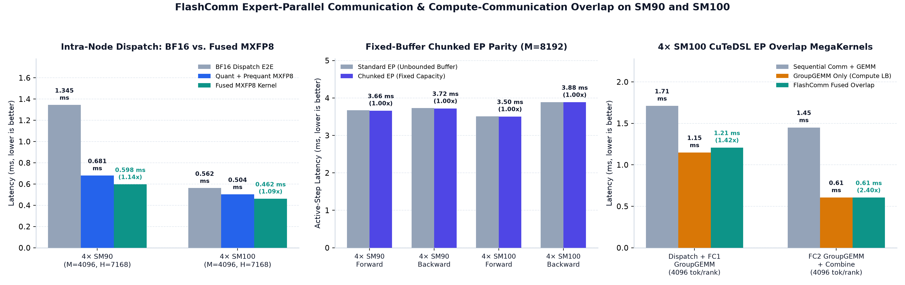

FlashComm: Expert-Parallel Communication & Overlap Library
==========================================================

**FlashComm** (located under ``FlashComm/``) is a high-performance Expert-Parallel (EP)
communication and compute-communication overlap library for **SM90** and **SM100** GPUs.
It combines custom CUDA/PTX intra-node NVLink and cross-node RDMA/GIN communication
kernels with CuTeDSL persistent MegaKernels that fuse MoE communication directly with
expert ``GroupGEMM`` computation.

----

Key Capabilities
----------------

- **High-Bandwidth Intra-Node & Cross-Node EP** (``flash_comm.ep.EPKernels``):
  Deduplicated per-target-rank token dispatch and weighted/zero-copy combine over
  NVLink symmetric memory within a node and multi-NIC NCCL GIN / RDMA across nodes,
  supporting both prefill (high-token) and low-latency decode regimes with bitwise
  determinism.
- **Fused MXFP8 Intra-Node Dispatch**:
  Quantizes ``BF16`` activations to block-scaled ``MXFP8`` (32-element blocks with
  ``UE8M0`` scales) on the fly inside the NVLink dispatch kernel, cutting remote wire
  payload in half while hiding quantization latency behind NVLink transfers.
- **Fixed-Buffer Chunked EP** (``flash_comm.ep.EPChunkPlanner``):
  Executes arbitrary-size EP ``dispatch`` and ``combine`` workloads in bounded steps
  over a fixed-capacity symmetric buffer so peak EP memory no longer scales with
  worst-case routing imbalance.
- **CuTeDSL Compute-Communication Overlap MegaKernels** (``flash_comm.ep_overlap.EPOverlapKernels``):
  Fuses ``Dispatch + FC1 GroupGEMM`` (pull/push TMA + persistent grouped GEMM) and
  ``FC2 GroupGEMM + Combine`` into single persistent kernels across both intra-node
  and inter-node topologies on **SM90** and **SM100**.

----

Module Overview & Quick Start
-----------------------------

Building FlashComm
~~~~~~~~~~~~~~~~~~

.. code-block:: bash

   cd FlashComm
   # Build for SM90, SM100, or both (e.g. "9.0a" or "10.0a;9.0")
   CUSTOM_CUDA_ARCH="10.0a;9.0" pip install -e . --no-build-isolation

Core Python APIs
~~~~~~~~~~~~~~~~

1. **Standard & Fused MXFP8 EP** (``flash_comm.ep``):

   .. code-block:: python

      from flash_comm.ep import EPKernels, EPCommLayoutDesc

      ep = EPKernels(
          max_m=4096,
          hidden=7168,
          topk=8,
          num_experts=256,
          local_world_size=local_world_size,
          ep_group=ep_group,
          num_sm=16,
      )
      layout = EPCommLayoutDesc()

      # Standard BF16 dispatch & combine
      recv_tokens, recv_weights, layout = ep.dispatch(x_bf16, topk_indices, topk_weights, layout)
      expert_in, expert_weights = ep.dispatch_postprocess(recv_tokens, recv_weights, layout)
      ...
      combined_out, _ = ep.combine(expert_out_preprocessed, layout)

      # Fused MXFP8 intra-node dispatch (quantizes BF16 -> packed MXFP8 in-kernel)
      packed_mxfp8, recv_w, layout = ep.dispatch_mxfp8_intranode(
          x_bf16, topk_indices, topk_weights, layout
      )
      mxfp8_q, mxfp8_scales, expert_w = ep.dispatch_mxfp8_intranode_postprocess(
          packed_mxfp8, recv_w, layout
      )

2. **Fixed-Buffer Chunked EP** (``EPChunkPlanner``):

   .. code-block:: python

      from flash_comm.ep import EPChunkPlanner

      planner = EPChunkPlanner(
          max_num_tokens=8192,
          chunk_size=1024,
          num_experts=256,
          group=ep_group,
          local_world_size=local_world_size,
      )
      offsets, _ = ep.compute_stable_local_token_within_expert_offset_and_expert_counts(topk_indices)
      plan = planner.build(topk_indices, recv_capacity_tokens=fixed_capacity, expert_alignment=128)
      chunk_layouts = ep.prepare_chunk_layouts(topk_indices, offsets, plan)

      for step_layout in chunk_layouts:
          recv_step, w_step, step_layout = ep.dispatch(x_bf16, topk_indices, topk_weights, step_layout)
          ...

3. **CuTeDSL EP Overlap MegaKernels** (``EPOverlapKernels``):

   .. code-block:: python

      from flash_comm.ep_overlap import EPOverlapKernels

      overlap = EPOverlapKernels(
          max_m=4096,
          hidden=7168,
          topk=8,
          num_experts=256,
          local_world_size=local_world_size,
          ep_group=ep_group,
          expert_alignment=256,
      )
      # Fused Dispatch + Expert FC1 GroupGEMM
      fc1_out, layout = overlap.dispatch_group_gemm(x_bf16, w_fc1, topk_indices)
      # Fused Expert FC2 GroupGEMM + Combine
      combined = overlap.group_gemm_combine(fc2_in, w_fc2, layout)

----

Performance Benchmarks on SM90 and SM100
----------------------------------------

All measurements below are collected on 4-GPU intra-node NVLink configurations on
**SM90** and **SM100** architectures with full numerical / bitwise verification
enabled (`N = 7168`, `G = 256` experts, `topk = 8`).

1. Intra-Node BF16 EP (Prefill & Low-Latency Decode)
~~~~~~~~~~~~~~~~~~~~~~~~~~~~~~~~~~~~~~~~~~~~~~~~~~~~

======================= ======================== ===================== ===================== ===================== ==============================================
Architecture            Regime (Tokens / Rank)   Layout Build          Dispatch E2E          Combine E2E           Kernel Bandwidth Breakdown
======================= ======================== ===================== ===================== ===================== ==============================================
4× **SM90**             Prefill (``M = 4096``)   0.080 ms              1.345 ms              1.570 ms              149–152 GB/s remote NVLink wire; 3,004 GB/s HBM postprocess
4× **SM90**             Decode (``M = 128``)     0.076 ms              0.298 ms (32 µs NVL)  **0.080 ms** (41 µs)  147 GB/s dispatch NVLink; 2,663 GB/s HBM preprocess
4× **SM100**            Prefill (``M = 4096``)   0.148 ms              **0.562 ms**          **0.690 ms**          2.39× faster dispatch & 2.28× faster combine vs. 4× SM90
4× **SM100**            Decode (``M = 128``)     0.154 ms              0.623 ms              **0.119 ms**          Bitwise identical to PyTorch reference
======================= ======================== ===================== ===================== ===================== ==============================================

2. Fused MXFP8 Intra-Node Dispatch (``M = 4096, H = 7168, G = 256, K = 8``)
~~~~~~~~~~~~~~~~~~~~~~~~~~~~~~~~~~~~~~~~~~~~~~~~~~~~~~~~~~~~~~~~~~~~~~~~~~~

Sending packed ``MXFP8`` rows (`7,424` bytes/row vs. `14,336` bytes/row in ``BF16``)
halves remote NVLink traffic while fusing quantization directly into the dispatch
kernel (`8` SMs):

======================= ============================ ============================ ============================ ==================================== ===============================
Architecture            Standalone Quant (8 SM)      Quant + Prequant Dispatch    **Fused MXFP8 Kernel**       Speedup vs. Separate Quant+Dispatch  Speedup vs. BF16 Dispatch
======================= ============================ ============================ ============================ ==================================== ===============================
4× **SM90**             0.124 ms (719.7 GB/s HBM)    0.681 ms (121.0 GB/s wire)   **0.598 ms** (137.8 GB/s)    **1.14×** (92.9% of comm-only roof)  **2.25×** kernel / **1.49×** E2E
4× **SM100**            0.088 ms (1,010.5 GB/s HBM)  0.504 ms (163.5 GB/s wire)   **0.462 ms** (178.2 GB/s)    **1.09×** (80.5% of comm-only roof)  **1.22×** vs. BF16 E2E
======================= ============================ ============================ ============================ ==================================== ===============================

3. Fixed-Buffer Chunked EP vs. Standard Unbounded EP (``M = 8192, Chunk = 1024``)
~~~~~~~~~~~~~~~~~~~~~~~~~~~~~~~~~~~~~~~~~~~~~~~~~~~~~~~~~~~~~~~~~~~~~~~~~~~~~~~~~

``EPChunkPlanner`` bounds peak receive memory to ``capacity_chunks`` without penalizing
active communication steps, while empty tail chunks retire in `12–18 µs`:

======================= ======================== =========================== =========================== =========================== ===========================
Architecture            Layout / Plan Build      Standard Forward            **Chunked Range Forward**   Standard Backward           **Chunked Range Backward**
======================= ======================== =========================== =========================== =========================== ===========================
4× **SM90**             33.2 µs / 52.8 µs        3.673 ms                    **3.659 ms (1.00×)**        3.732 ms                    **3.720 ms (1.00×)**
4× **SM100**            38.0 µs / 68.6 µs (min)  3.510 ms                    **3.503 ms (1.00×)**        3.891 ms                    **3.885 ms (1.00×)**
======================= ======================== =========================== =========================== =========================== ===========================

4. CuTeDSL Fused Compute-Communication Overlap on 4× SM100
~~~~~~~~~~~~~~~~~~~~~~~~~~~~~~~~~~~~~~~~~~~~~~~~~~~~~~~~~~

Measured with ``tokens/rank = 4096`` (`valid_M ≈ 29,387` routed rows/rank),
``hidden_size = 7168``, ``intermediate_size = 2048``, ``num_experts = 256``, ``topk = 8``:

=========================================== ============================ ============================ ============================================= ========================
Fused MoE Stage (4× **SM100**)              Sequential Baseline          GroupGEMM Only (Compute LB)  **FlashComm Fused Overlap Kernel**            Overlap Speedup
=========================================== ============================ ============================ ============================================= ========================
``Dispatch + FC1 GroupGEMM``                1.710 ms (0.562 + 1.149 ms)  1.149 ms (1,502.3 TFLOPS)    **1.208 ms** (1,428.7 TF + 348.8 GB/s disp.)  **1.42×** (89% comm hidden)
``FC2 GroupGEMM + Combine``                 1.450 ms (measured seq.)     0.606 ms (1,423.4 TFLOPS)    **0.605 ms** (1,425.7 TF + 696.2 GB/s comb.)  **2.40×** kernel / **1.17×** mean E2E (0.746 ms min E2E)
=========================================== ============================ ============================ ============================================= ========================

----

Reproducing FlashComm Benchmarks
--------------------------------

.. code-block:: bash

   cd FlashComm
   export PYTHONPATH="$PWD/python:$PWD/tests/ep:$PWD/tests/ep_overlap"

   # 1. Intra-node BF16 EP (prefill M=4096 and decode M=128)
   torchrun --standalone --nproc_per_node=4 tests/ep/test_ep_intranode.py \
       -M 4096 -N 7168 -G 256 --topk 8 --rounds 1 --profile --enable-local-combine --disable-weight-combine
   torchrun --standalone --nproc_per_node=4 tests/ep/test_ep_intranode.py \
       -M 128 -N 7168 -G 256 --topk 8 --rounds 1 --profile --enable-local-combine --disable-weight-combine

   # 2. Fused MXFP8 Intra-node Dispatch
   torchrun --standalone --nproc_per_node=4 tests/ep/test_mxfp8_dispatch_intranode.py \
       -M 4096 -N 7168 -G 256 --topk 8 --rounds 1 --profile

   # 3. Fixed-Buffer Chunked EP
   torchrun --standalone --nproc_per_node=4 tests/ep/test_ep_chunked_perf.py \
       --local-world-size 4 --num-experts 256 --capacity-chunks 8 --interleave-active

   # 4. CuTeDSL Fused Dispatch+GroupGEMM & GroupGEMM+Combine
   torchrun --standalone --nproc_per_node=4 tests/ep_overlap/test_ep_overlap_dispatch_group_gemm.py \
       --num_tokens 4096 --hidden_size 7168 --intermediate_size 2048 --num_experts 256 --topk 8 \
       --local_world_size 4 --rounds 1 --iters 20 --warmup_iters 10
   torchrun --standalone --nproc_per_node=4 tests/ep_overlap/test_ep_overlap_group_gemm_combine.py \
       --num_tokens 4096 --hidden_size 7168 --intermediate_size 2048 --num_experts 256 --topk 8 \
       --local_world_size 4 --rounds 1 --iters 20 --warmup_iters 10

----

References
----------

- **UniEP (HPDC '26)** — `UniEP: Unified Expert-Parallel MegaKernel MoE for LLM Training <https://dl.acm.org/doi/10.1145/3806645.3807818>`_
- **DITRON (ICML 2026)** — `DITRON: Distributed Multi-level Tiling Compiler for Parallel Tensor Programs <https://icml.cc/virtual/2026/poster/63503>`_
