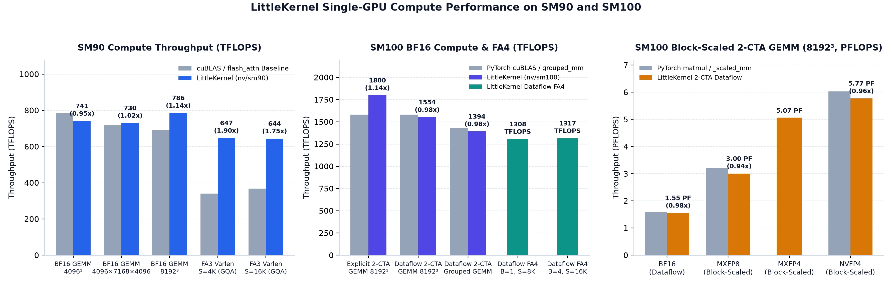
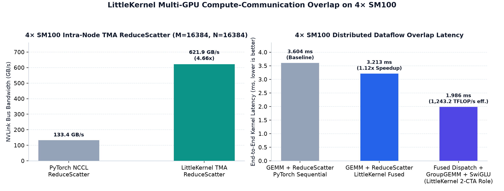

Performance Benchmarks (SM90, SM100 & GFX950)
=============================================

This page summarizes empirical single-GPU compute and multi-GPU compute-communication
overlap performance for **LittleKernel** across **SM90** (``nv/sm90``) and **SM100**
(``nv/sm100``), along with benchmark suite coverage for **GFX950** (``amd/cdna4``).

All benchmark numbers reported below are measured with numerical verification
enabled against PyTorch / cuBLAS / SDPA reference implementations.

----

SM90 Compute Benchmarks (``nv/sm90``)
-------------------------------------

BF16 Dense GEMM Progression vs. cuBLAS
~~~~~~~~~~~~~~~~~~~~~~~~~~~~~~~~~~~~~~

Under ``benchmarks/nv/sm90/gemm/``, LittleKernel provides a progressive series of
authored **SM90** BF16 GEMM kernels illustrating warp specialization, multistage
``TMA`` software pipelining, async warpgroup scheduling, cluster ``TMA`` multicast,
and swizzled ``STSM`` shared-memory epilogues:

- **Level 6** (``sm90_warp_specialized_multistage.py``): Basic producer/consumer
  warp-group split with multistage ``TMA`` + ``WGMMA``.
- **Level 9** (``sm90_async_warpgroup_scheduling.py``): Asynchronous multi-warpgroup
  scheduling with deep ``mbarrier`` pipelines.
- **Level 10** (``sm90_deepgemm_full_optimizations.py``): Persistent cluster-scheduled
  ``TMA`` multicast, swizzled ``STSM`` epilogue, and full warp-group specialization.

.. list-table::
   :header-rows: 1

   * - Problem Shape (M × N × K)
     - LK Level 6
     - LK Level 9
     - LK Level 10
     - ``torch.matmul`` (cuBLAS)
     - Best LK vs. cuBLAS
   * - ``2048 × 2048 × 2048``
     - 204.2 TFLOPS
     - **488.0 TFLOPS**
     - 480.0 TFLOPS (0.036 ms)
     - 673.8 TFLOPS (0.025 ms)
     - 0.72×
   * - ``4096 × 4096 × 4096``
     - 231.1 TFLOPS
     - 715.5 TFLOPS
     - **741.0 TFLOPS** (0.185 ms)
     - 784.0 TFLOPS (0.175 ms)
     - **0.95×**
   * - ``4096 × 7168 × 4096``
     - 207.5 TFLOPS
     - 722.1 TFLOPS
     - **730.0 TFLOPS** (0.329 ms)
     - 718.2 TFLOPS (0.335 ms)
     - **1.02×**
   * - ``8192 × 8192 × 8192``
     - 186.3 TFLOPS
     - **785.5 TFLOPS** (1.400 ms)
     - 695.3 TFLOPS (1.581 ms)
     - 690.4 TFLOPS (1.593 ms)
     - **1.14×** (Lv9) / **1.01×** (Lv10)

FlashAttention-3 Variable-Length Causal GQA
~~~~~~~~~~~~~~~~~~~~~~~~~~~~~~~~~~~~~~~~~~~

``benchmarks/nv/sm90/flashattention/level6/flash_attn_varlen.py`` implements a full
warp-specialized **SM90** FlashAttention-3 forward kernel with variable-length
cumulative sequence offsets (``cu_seqlens``), causal masking, Grouped-Query Attention
(GQA, ``headdim = 128``, BF16), and ``TMA`` 3D descriptor loads:

.. list-table::
   :header-rows: 1

   * - Workload (Batch, SeqLen, Q/KV Heads)
     - LittleKernel FA3 (``nv/sm90``)
     - ``flash_attn_varlen_func`` Baseline
     - Speedup vs. Baseline
     - Cosine Sim.
   * - ``B=4, S=1024, H=16/4, D=128``
     - 0.054 ms (**320.8 TFLOPS**)
     - 0.092 ms (187.2 TFLOPS)
     - **1.71×**
     - 0.999999
   * - ``B=8, S=2048, H=32/8, D=128``
     - 0.483 ms (**569.1 TFLOPS**)
     - 0.858 ms (320.6 TFLOPS)
     - **1.78×**
     - 0.999999
   * - ``B=8, S=4096, H=32/8, D=128``
     - 1.700 ms (**646.9 TFLOPS**)
     - 3.235 ms (340.0 TFLOPS)
     - **1.90×**
     - 0.999998
   * - ``B=8, S=4096, H=64/8, D=128``
     - 3.565 ms (**617.0 TFLOPS**)
     - 6.334 ms (347.3 TFLOPS)
     - **1.78×**
     - 0.999998
   * - ``B=4, S=8192, H=32/8, D=128``
     - 3.534 ms (**622.4 TFLOPS**)
     - 6.080 ms (361.7 TFLOPS)
     - **1.72×**
     - 0.999998
   * - ``B=4, S=16384, H=32/8, D=128``
     - 13.661 ms (**643.9 TFLOPS**)
     - 23.927 ms (367.7 TFLOPS)
     - **1.75×**
     - 0.999998

----

SM100 Compute Benchmarks (``nv/sm100``)
---------------------------------------

Explicit 2-CTA ``UMMA`` + ``TMEM`` BF16 GEMM
~~~~~~~~~~~~~~~~~~~~~~~~~~~~~~~~~~~~~~~~~~~~

``benchmarks/nv/sm100/gemm/sm100_deepgemm_matching_architecture.py`` uses explicit
2-CTA ``tcgen05.mma.cta_group::2`` (``UMMA``), Tensor Memory (``TMEM``) accumulators,
2-CTA multicast ``TMA`` staging, and persistent cluster tile scheduling on **SM100**:

.. list-table::
   :header-rows: 1

   * - Problem Shape (M × N × K)
     - LittleKernel Explicit (``nv/sm100``)
     - ``torch.matmul`` (cuBLAS)
     - LK vs. cuBLAS
   * - ``2048 × 2048 × 2048``
     - 0.028 ms (**612.3 TFLOPS**)
     - —
     - PASS
   * - ``4096 × 4096 × 4096``
     - 0.092 ms (**1,486.9 TFLOPS**)
     - —
     - PASS
   * - ``8192 × 8192 × 8192``
     - 0.611 ms (**1,800.3 TFLOPS**)
     - 0.695 ms (1,581.2 TFLOPS)
     - **1.14×**

Auto-Pipelined Role & Dataflow Kernels (``frontend=dataflow_frontend``)
~~~~~~~~~~~~~~~~~~~~~~~~~~~~~~~~~~~~~~~~~~~~~~~~~~~~~~~~~~~~~~~~~~~~~~~

Under ``benchmarks/nv/sm100/dataflow/``, kernels written in the declarative **SM100**
Role & Dataflow frontend let the compiler automatically synthesize multi-stage
``SMEM`` / ``TMEM`` overlays, ``mbarrier`` phase tracking, ``tcgen05.commit``
completion, and ``TMA`` bulk-group retirements:

.. list-table::
   :header-rows: 1

   * - Operator & Shape
     - Precision
     - LittleKernel Dataflow
     - PyTorch / cuBLAS Baseline
     - Relative Perf
   * - 2-CTA Dense GEMM (``8192 × 8192 × 8192``)
     - BF16
     - 0.708 ms (**1,553.8 TFLOPS**)
     - 0.695 ms (1,581.2 TFLOPS, ``matmul``)
     - **0.98×**
   * - 2-CTA Block-Scaled GEMM (``8192 × 8192 × 8192``)
     - ``MXFP8`` (E4M3)
     - 0.366 ms (**3,003.5 TFLOPS**)
     - 0.343 ms (3,202.8 TFLOPS, ``_scaled_mm``)
     - **0.94×**
   * - 2-CTA Block-Scaled GEMM (``8192 × 8192 × 8192``)
     - ``MXFP4`` (E2M1)
     - 0.217 ms (**5,071.5 TFLOPS**)
     - Verified vs. exact dequant ref
     - **5.07 PFLOPS**
   * - 2-CTA Block-Scaled GEMM (``8192 × 8192 × 8192``)
     - ``NVFP4`` (E2M1)
     - 0.191 ms (**5,770.9 TFLOPS**)
     - 0.182 ms (6,034.4 TFLOPS, ``_scaled_mm``)
     - **0.96×**
   * - 2-CTA MoE Grouped GEMM (``E=40, M=29440, N=5120, K=8192``)
     - BF16
     - 1.772 ms (**1,393.6 TFLOPS**)
     - 1.729 ms (1,428.3 TFLOPS, ``grouped_mm``)
     - **0.98×**
   * - FlashAttention-4 Causal Fwd (``B=1, S=8192, H=32/8``)
     - BF16 (``D=128``)
     - 1.681 ms (**1,307.8 TFLOPS**)
     - Verified vs. PyTorch SDPA
     - PASS
   * - FlashAttention-4 Causal Fwd (``B=4, S=16384, H=32/8``)
     - BF16 (``D=128``)
     - 26.718 ms (**1,316.9 TFLOPS**)
     - Verified vs. PyTorch SDPA
     - PASS

----

SM100 Multi-GPU Compute-Communication Overlap (4× SM100)
--------------------------------------------------------

LittleKernel's **SM100** Role & Dataflow compiler also compiles persistent
multi-GPU compute-communication overlapping kernels over intra-node NVLink symmetric
memory:

.. list-table::
   :header-rows: 1

   * - Distributed Workload (4× **SM100** Intra-Node NVLink)
     - PyTorch / NCCL Baseline
     - LittleKernel (``nv/sm100``)
     - Key Highlight
   * - Standalone ``TMA`` ReduceScatter (``M=16384, N=16384``, BF16)
     - 3.019 ms (133.4 GB/s busbw)
     - **0.647 ms (621.9 GB/s)**
     - **4.66×** higher NVLink busbw
   * - Fused ``GEMM + ReduceScatter`` (``M=16384, N=16384, K=8192``)
     - 3.604 ms (sequential)
     - **3.213 ms** (fused overlap)
     - **1.12×** end-to-end speedup
   * - Fused ``Dispatch + GroupGEMM + SwiGLU`` (``4096 tok/rank, E=160, K=8``)
     - Verified vs. PyTorch ref
     - **1.986 ms (1,243.2 TFLOP/s)**
     - Single persistent 2×2 cluster kernel

----

GFX950 Benchmark Coverage (``amd/cdna4``)
-----------------------------------------

For **GFX950** GPUs, LittleKernel includes progressive ``MXFP8`` block-scaled
``MFMA`` GEMM benchmarks under ``benchmarks/amd/cdna4/gemm/`` covering:

- Global-to-LDS direct DMA (``buffer_load ... lds``),
- XOR-swizzled LDS staging to eliminate bank conflicts,
- 8-wave warp specialization and double-buffered K-loop software pipelining,
- XCD-aware persistent tile scheduling.

----

Reproducing Benchmarks
----------------------

.. code-block:: bash

   export PYTHONPATH="python:."

   # SM90 BF16 GEMM (Level 10)
   python3 benchmarks/nv/sm90/gemm/sm90_deepgemm_full_optimizations.py

   # SM100 Explicit 2-CTA BF16 GEMM
   python3 benchmarks/nv/sm100/gemm/sm100_deepgemm_matching_architecture.py

   # SM100 Auto-Pipelined Dataflow GEMMs & FA4
   python3 benchmarks/nv/sm100/dataflow/bench_gemm_sm100.py
   python3 benchmarks/nv/sm100/dataflow/bench_mxfp8_gemm.py
   python3 benchmarks/nv/sm100/dataflow/bench_mxfp4_gemm.py
   python3 benchmarks/nv/sm100/dataflow/bench_nvfp4_gemm.py
   python3 benchmarks/nv/sm100/dataflow/bench_grouped_gemm.py
   python3 benchmarks/nv/sm100/dataflow/bench_fa4_attention_sm100.py

   # 4x SM100 Distributed Overlap Benchmarks
   torchrun --standalone --nproc_per_node=4 benchmarks/nv/sm100/dataflow/bench_gemm_reduce_scatter_sm100.py
   torchrun --standalone --nproc_per_node=4 benchmarks/nv/sm100/dataflow/bench_dispatch_group_gemm_swiglu_sm100.py

   # GFX950 Block-Scaled MXFP8 MFMA GEMM
   python3 benchmarks/amd/cdna4/gemm/test_mxfp8_gemm_level5.py
